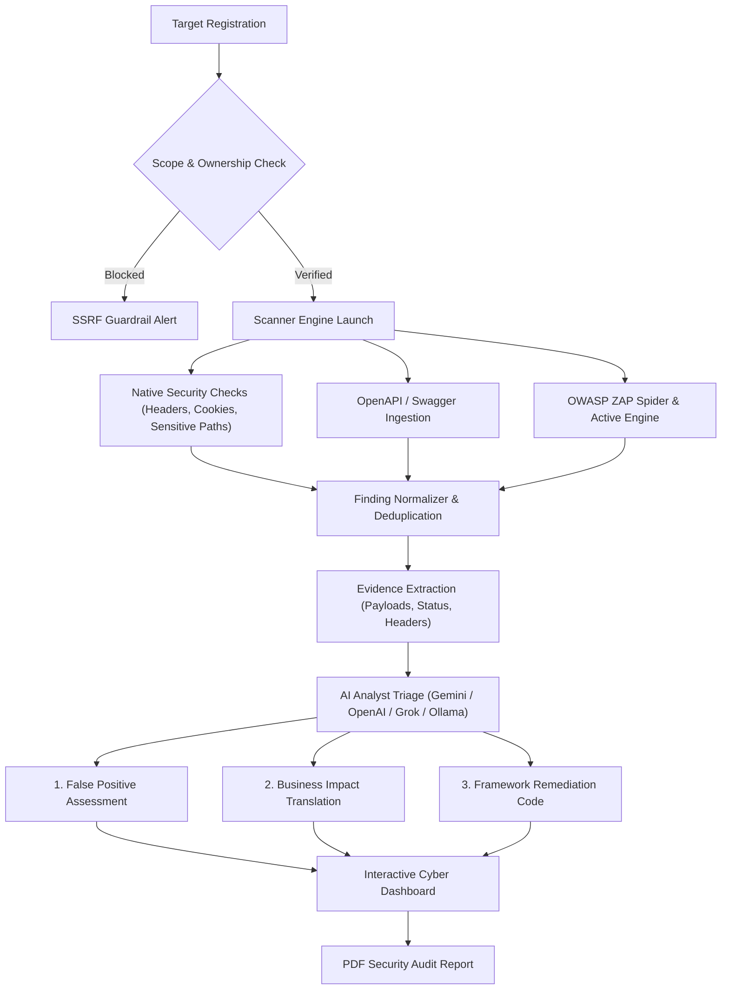

<div align="center">

# 🛡️ QYBERVEIL

### **Discover Vulnerabilities. Understand Risk. Secure with Confidence.**

*An AI-powered, production-minded application security assessment platform built for developers, AppSec teams, and security auditors.*

---

[](https://nodejs.org)
[](https://www.typescriptlang.org)
[](https://react.dev)
[](https://tailwindcss.com)
[](https://www.prisma.io)
[](https://www.docker.com)
[](LICENSE)

[Features](#-key-features) • [How It Works](#-how-qyberveil-works) • [Comparison](#-traditional-scanners-vs-qyberveil) • [Quickstart](#-quickstart-guide) • [AI Subsystem](#-evidence-grounded-ai-system) • [Architecture](#-system-architecture) • [Security](#-security-boundaries--guardrails)

---

</div>

## 💡 Why Qyberveil?

Most application security tools (DAST scanners) dump **hundreds of cryptic alerts** with high false-positive rates. Developers waste hours Googling generic error descriptions like `CWE-1021`, while security teams suffer from **alert fatigue**.

**Qyberveil bridges the gap between scanning and fixing.** It automates vulnerability scanning, strictly limits scans to verified authorized scopes, validates raw HTTP evidence, and uses **provider-agnostic AI** (Gemini, OpenAI, Grok, or offline Ollama) to:

1. **Eliminate False Positives:** Verify if the vulnerability was actually triggered based on HTTP evidence.
2. **Explain Real Business Impact:** Translate technical findings into executive risk narratives.
3. **Generate Framework-Specific Code Fixes:** Deliver copy-paste code patches (Express, Python FastAPI, Django, Spring Boot, etc.).
4. **Produce Audit-Ready PDF Reports:** Generate executive summaries and detailed technical breakdowns in one click.

---

## ⚡ Traditional Scanners vs. Qyberveil

```
Traditional Scanners (Burp, Nessus, Acunetix)
  ❌ Dumps 500+ raw, unverified alerts
  ❌ Generic remediation: "Sanitize all user inputs"
  ❌ High rate of false positives wasting engineering sprints
  ❌ High annual license costs ($15k–$50k/year)

Qyberveil AI Platform
  ✅ Grounds findings strictly in captured HTTP request/response evidence
  ✅ Delivers copy-paste remediation code tailored to your exact tech stack
  ✅ AI filters out false positives with rationales and confidence scores
  ✅ 100% Free & Open-Source with offline AI (Ollama) or cloud models (Gemini/OpenAI)
```

---

## 🎯 Who is Qyberveil For?

| Persona | How Qyberveil Helps |
| :--- | :--- |
| 🧑‍💻 **Developers** | Get exact code snippets and regression `curl` tests to fix security issues in minutes without needing a cybersecurity degree. |
| 🛡️ **AppSec Engineers** | Automate initial alert triage and eliminate false positives, saving dozens of hours each week. |
| 🚀 **Startups & SMBs** | Run continuous, enterprise-grade penetration testing without hiring expensive external auditing agencies. |
| 📋 **Auditors & CISOs** | One-click export of compliance-ready PDF reports with severity scorecards and target authorization audit trails. |

---

## 🚀 Key Features

### 🔍 1. Multi-Vector Vulnerability Scanning
* **OpenAPI & Swagger Discovery:** Automatically parses API specifications (`/openapi.json`, Swagger UI) to map routes, methods, request bodies, and authentication schemes.
* **Native Baseline Probes:** Inspects critical security headers (`HSTS`, `CSP`, `X-Frame-Options`, `X-Content-Type-Options`, banner disclosures) and cookie attributes (`HttpOnly`, `Secure`, `SameSite`).
* **OWASP ZAP Integration:** Integrates with OWASP ZAP for spidering, crawling, and active parameter probing.

### 🧠 2. Evidence-Grounded AI Security Analyst
* **Provider Flexibility:** Native adapters for **Google Gemini** (`gemini-2.0-flash`), **OpenAI** (`gpt-4o`, `o3-mini`), **xAI Grok** (`grok-2`), or **100% Offline Local Ollama** (`llama3.3`, `deepseek-r1`).
* **Zero Hallucination Guarantee:** The AI evaluates only captured HTTP evidence (status codes, payloads, headers) wrapped in strict anti-prompt-injection isolation tags.
* **Automated Regression Verification:** Generates ready-to-run `curl` commands and test assertions to verify fixes before deploying.

### 🛡️ 3. Scope Control & SSRF Guardrails
* **Mandatory Target Authorization:** Requires verified domain ownership via **DNS TXT records**, **HTTP file tokens**, or documented authorization.
* **Anti-SSRF Protection:** Enforces strict boundary checks that reject private IP ranges (`10.0.0.0/8`, `172.16.0.0/12`, `192.168.0.0/16`), loopbacks (`127.0.0.1`, `localhost`), and cloud metadata services (`169.254.169.254`).

### 📊 4. Executive & Technical PDF Reports
* Generates professional, branded PDF reports containing:
  - Executive Risk Scorecards & Severity Heatmaps (Critical, High, Medium, Low).
  - Assessment Scope, Target URL, and timestamped audit metadata.
  - Detailed vulnerability breakdowns with CWE/CVSS mapping, proof-of-exploit evidence, and code fixes.

### 🔐 5. Zero-Exposure Key Security
* API keys are encrypted at rest using **Authenticated AES-256-GCM** (random 96-bit IV + 128-bit auth tag).
* Raw plaintext keys are never returned to client-side JavaScript or written to logs.

---

## 🔄 How Qyberveil Works



---

## 🏛️ System Architecture

Qyberveil is built as a modular monorepo:

```
qyberveil/
├── apps/
│   ├── web/              # Modern React + Vite + Tailwind CSS Dark Cyber Dashboard
│   └── api/              # Node.js + Express.js REST API with Helmet & Zod validation
├── packages/
│   ├── shared-types/     # Shared TypeScript domain contracts, Enums & API envelopes
│   ├── validation/       # Runtime Zod validation schemas & SSRF boundary guards
│   ├── ai-providers/     # Multi-provider adapters (Gemini, OpenAI, Grok, Ollama)
│   ├── scanner/          # Core scanning engine, scope validator & alert normalizer
│   └── reports/          # High-fidelity PDF report generation engine (PDFKit)
├── workers/
│   └── scan-worker/      # Isolated Docker background worker running BullMQ
├── prisma/
│   └── schema.prisma     # PostgreSQL data model (11 models, relations, cascades)
├── docker-compose.yml    # Complete local development stack
├── docker-compose.prod.yml # Production multi-tier stack with network isolation
```

---

## 🤖 Evidence-Grounded AI System

| Provider | Supported Models | Execution Mode | Best For |
| :--- | :--- | :--- | :--- |
| **Google Gemini** | `gemini-2.0-flash` (Default), `gemini-1.5-pro` | Cloud API | Ultra-fast triage, large context windows, native JSON mode. |
| **OpenAI** | `gpt-4o` (Default), `gpt-4o-mini`, `o3-mini` | Cloud API | Industry-benchmark AppSec reasoning and precision code fixes. |
| **xAI Grok** | `grok-2` (Default), `grok-beta` | Cloud API | Deep technical vulnerability analysis and exploit logic validation. |
| **Ollama** | `llama3.3` (Default), `deepseek-r1`, `qwen2.5-coder` | **100% Local / Offline** | Private environments, zero data leakage, zero API subscription cost. |

---

## ⚡ Quickstart Guide

### Prerequisites
* **Node.js**: `v20.0.0` or higher
* **npm**: `v10.0.0` or higher
* **Docker & Docker Compose** (recommended for full stack with PostgreSQL and Redis)

---

### Option A: 🐳 Docker Compose (Easiest)

Spin up the entire stack (Postgres, Redis, API, Web, Ollama, and Worker) in one command:

```bash
# 1. Clone the repository
git clone https://github.com/your-username/Qyberveil-CS-application.git
cd Qyberveil-CS-application

# 2. Setup your environment file
cp .env.example .env

# 3. Boot all services
docker compose up -d
```

* **Web Dashboard:** [http://localhost:5173](http://localhost:5173)
* **API Server:** [http://localhost:4000](http://localhost:4000)
* **API Healthcheck:** [http://localhost:4000/health](http://localhost:4000/health)

---

### Option B: 💻 Local Node.js Development

If you prefer to run services locally:

```bash
# 1. Install dependencies across all monorepo packages
npm install

# 2. Configure environment
cp .env.example .env

# 3. Generate Prisma client & push schema
npm run db:generate
npm run db:push

# 4. Start both API and Web concurrently
npm run dev
```

Or run individual workspaces:
```bash
npm run dev:api    # Starts API on http://localhost:8000 (or PORT from .env)
npm run dev:web    # Starts Web Vite dev server on http://localhost:5173
```

---

## 🧪 Testing

Run the automated test suites across all packages:

```bash
npm test
```

Build all packages for production:
```bash
npm run build
```

---

## 🔒 Security Boundaries & Guardrails

1. **Target Authorization:** Active scans require prior domain verification via DNS TXT records (`qyberveil-verify=...`) or HTTP token files.
2. **SSRF Boundary Enforcement:** The platform actively blocks loopback addresses, internal subnets, and cloud infrastructure metadata endpoints.
3. **Evidence Isolation:** All untrusted web inputs harvested from scanned targets are strictly sanitized and enclosed in boundary tags `<untrusted_scanner_evidence>` to prevent prompt-injection attacks against the AI.
4. **Secret Protection:** Provider credentials are encrypted using authenticated AES-256-GCM. Decrypted keys never enter client-side state or server access logs.

---

## 📄 License

This project is licensed under the [MIT License](LICENSE).

---

<div align="center">
  <sub>Built with ❤️ for modern software development and application security.</sub>
</div>
